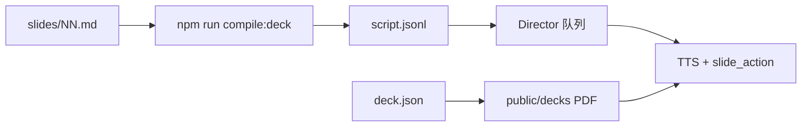

# content/decks 答辩内容包

Phase 1 Step 2：用 **Markdown 写讲稿**，编译为 `DirectorAction` 队列，驱动 Present 模式播放 + PDF 翻页。

## 示例 vs 私有

| 根目录 | Git | 用途 |
|--------|-----|------|
| `content/` | ✅ | 公开示例（当前：`demo`） |
| `content-private/` | ❌ | 真实答辩；布局与 `content/` 相同 |
| `public/decks/demo/` | ✅ | 示例 PDF |
| `public/decks/<其他>/` | ❌ | 私有 PDF |

运行时 `/content/…`：**先私有、后示例**。编辑/编译 API：已有私有场次写私有；仅有示例场次写示例；全新 `deckId` 默认写 **`content-private/`**。

详见 [`content/README.md`](../content/README.md)、[`content-private/README.md`](../content-private/README.md)。

## 工作流

1. 准备 PDF → `apps/presenter-onair/public/decks/<deckId>/slides.pdf`
2. 新建 `content/decks/<deckId>/deck.json`
3. 在 `slides/` 下按页写 `01.md`、`02.md` …
4. 运行 `npm run compile:deck`（或 `npm run compile:deck -w @ssreporter/director`）
5. `npm run dev` → 汇报模式 → 导演台 **播放本场讲稿**

> **私有场次更省事的路径**：`npm run dev` → 界面切换 **场次库** → 选 PDF 导入，
> 会自动按 PDF 页数在 `content-private/` 下建好 `deck.json` / 每页讲稿并编译。
> 详见下方「场次库（应用内导入）」。



## deck.json

```json
{
  "id": "demo",
  "title": "答辩示例",
  "slideSource": {
    "type": "pdf",
    "url": "/decks/demo/slides.pdf"
  },
  "scriptUrl": "/content/decks/demo/script.jsonl"
}
```

| 字段 | 说明 |
|------|------|
| `id` | 与目录名一致 |
| `title` | 汇报工具栏标题 |
| `slideSource.url` | 相对 `public/` 的 PDF 路径 |
| `scriptUrl` | 可选；默认 `/content/decks/<id>/script.jsonl` |

开发时 Vite 通过 `/content/…` 直接读取仓库内 `content/` 目录（见 `vite-content-plugin.ts`）。

## slides/NN.md 格式（主格式）

文件名 = 页码（`01.md` → 第 1 页）。**一页可多节拍**：正文内用 `<!-- beat -->` 分段（见 [`phase3-present-director.md`](./phase3-present-director.md)）。

```markdown
---
emotion: friendly
gesture: wave_both
action_id: present-01
---

各位老师好，我是答辩助手。接下来由我介绍项目背景与目标。
```

| frontmatter | 必填 | 默认 | 说明 |
|-------------|------|------|------|
| （正文） | 是 | — | TTS 朗读全文 |
| `profile` | 否 | — | 表演预设（`performance.json`）；与 `emotion` 二选一或并用 |
| `emotion` | 否 | `neutral` | 等同 profile 名（兼容） |
| `gesture` | 否 | 第 1 页 `wave_both`，其余 `wave_right` | schema 枚举；语义手势（bow/nod/…）待自制 VRMA |
| `camera` | 否 | `bust` | |
| `action_id` | 否 | `p{NN}` | |
| `voice` / `voice_speed` | 否 | profile | 本拍语速等 |
| `timing` / `pause_*_ms` | 否 | profile | 播前/播后停顿 |

**表演预设**：`content/persona/performance.json`（全场）+ `content/decks/<id>/performance.json`（场次覆盖）。统一配置 VRM 表情/手势与 TTS 语速/停顿。

### 翻页规则（无需手写）

**唯一行为：一页讲稿全部念完，再翻到下一页。** 由编译器自动生成，讲稿里写 `slide_action` 不生效（会被忽略）。

编译产物里每页对应：

| 动作 | 何时执行 | 作用 |
|------|----------|------|
| 该页**第一个节拍**携带 `slide_action: {"goto": 页码}` | 该拍朗读**之前** | 把页面对准本页（正常连播是幂等操作，从别处开始播时能纠正） |
| 页末自动追加一条 **`turn-NN`** 动作（`utterance: ""` + `{"next": true}`） | 本页最后一拍朗读**结束之后** | 翻到下一页 |
| 最后一页 | — | 不再追加翻页动作 |

所以作者只需要按页写讲稿正文（一页可多节拍），**不用管翻页**。

## 编译

```bash
npm run compile:deck
# 指定场次（可选）
cd packages/director && DECK_ID=my-deck npm run compile:deck
```

输出：`content/decks/<deckId>/script.jsonl`（每行一条 `DirectorAction`）。

编译器：[`packages/director/src/compile-deck-script.ts`](../packages/director/src/compile-deck-script.ts)

## 播放

- 应用读取 `deck.json`（优先 `/content/decks/<id>/`）
- 讲稿读取 `scriptUrl` 指向的 `script.jsonl`
- Director 面板 **播放本场讲稿** → `validateDirectorAction` → 入队 → 顺序播放

`activeDeckId` 来自设置 `present.activeDeckId`（默认 `demo`）。

## 场次库（应用内导入 / 管理）

`npm run dev` 下，界面切换菜单里的 **场次库** 负责真实答辩的 PDF 全流程：

| 操作 | 行为 |
|------|------|
| 导入 PDF | 右上角**一个按钮**：选 PDF 即导入。**场次 ID 与标题自动生成**（ID 由文件名派生、重名自动追加 `_2`；标题取文件名），写入 `public/decks/<id>/slides.pdf`，生成 `content-private/decks/<id>/`（`deck.json`、`performance.json`、**按 PDF 页数生成每页** `slides/NN.md`、`faq/<id>.md`），并立即编译出 `script.jsonl` |
| 重命名 | 标题右侧铅笔图标；只改 `deck.json` 的 title（仅私有场次；示例场次只读） |
| 删除 | 卡片右下角垃圾桶图标；仅限私有场次：删除 `content-private/decks/<id>`、`public/decks/<id>` 与对应 FAQ |

> 场次库只做导入/管理，不提供「进导演台 / 去汇报」按钮——切换场次统一在
> **讲稿导演台顶栏**或**汇报顶栏**的「场次」下拉里做（两处共用 `present.activeDeckId`）。

> 不提供「按 PDF 补建讲稿」：本工程不能在内部修改 PDF，导入时已按页全量建好讲稿；
> 若 PDF 页数在外部变化，直接删除场次重新导入即可（ID 会自动避让）。

> ⚠️ 写盘接口（导入/重命名/删除/保存/编译）由 **dev 专用** Vite 插件提供，
> 生产构建里 `devApi` 为 false，页面会提示「仅 npm run dev 可用」。

## 新建一场答辩（私有，推荐）

**首选**：`npm run dev` → **场次库** → 导入 PDF（自动生成每页讲稿）。

命令行等价流程（不需要应用）：

```bash
npm run scaffold:deck -- --id my_defense --title "我的答辩" --pages 12
# 拷贝 PDF：apps/presenter-onair/public/decks/my_defense/slides.pdf
# 编辑 content-private/decks/my_defense/slides/*.md
# 编译：应用内「讲稿导演台 → 保存并编译」
```

> `npm run compile:deck` 只扫公开的 `content/` 根目录，**不能编译 `content-private/` 的场次**；
> 私有场次请用 **场次库 → 按 PDF 补建讲稿**（会顺带编译）或 **讲稿导演台 → 保存并编译**。

仅改公开示例时，继续编辑 `content/decks/demo/`。

## 应用内编辑（Phase 1.5）

`npm run dev` 下可用 **编辑讲稿** 模式（工具栏：聊天 / 汇报 / 讲稿导演台）：

- 顶栏左侧 **场次** 下拉：直接在导演台切换要编辑的答辩场次（与汇报共用 `present.activeDeckId`，切换后 PDF 与讲稿同步重载）
- 左侧：PDF 当前页预览
- 右侧：朗读文本、`emotion` / `gesture` 表单；翻页为固定行为（每页念完自动翻页）
- **保存本页**：写回对应根下 `decks/<id>/slides/NN.md`（仅 dev API）
- **保存并编译**：写盘 + 生成 `script.jsonl`
- 未保存修改自动写入 `localStorage` 草稿；可点「放弃草稿」恢复磁盘版本

改完后切到 **汇报** → Director **播放本场讲稿** 验收。

## 相关文件

| 用途 | 路径 |
|------|------|
| 编译器 | `packages/director/src/compile-deck-script.ts` |
| 编译 CLI | `packages/director/src/compile-deck-cli.test.ts` |
| 内容根解析 | `apps/presenter-onair/content-roots.ts` |
| 运行时加载讲稿 | `apps/presenter-onair/src/lib/content/loadDeckScript.ts` |
| deck 加载 | `apps/presenter-onair/src/lib/present/loadDeck.ts` |
| Director 面板 | `apps/presenter-onair/src/components/DirectorPanel.tsx` |
| demo 样例 | `content/decks/demo/` |

## 备选格式（后续）

单文件 `script.md` 用 `## 第 N 页` 分段——尚未实现，需要时可加解析器。
